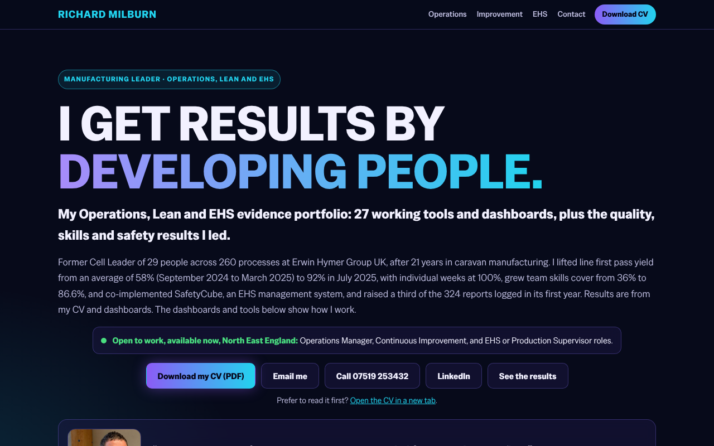

# Richard Milburn: Operations, Lean and EHS Evidence Portfolio

[Try it live](https://rmilburn1980.github.io/) · [Portfolio hub](https://rmilburn1980.github.io/)

Live site: https://rmilburn1980.github.io/

A hub of working tools and dashboards built from 21 years on a caravan production line, for Operations Manager, Continuous Improvement and EHS or Production Supervisor roles. Every tool is a single HTML page. There is no build step, no server of mine and no sign-in. Open a page and use it.

## What is in it

27 tools. Every link opens the working page.

### Operations
| Tool | What it does |
|---|---|
| [SQCDP Interview Evidence Dashboard](https://rmilburn1980.github.io/sqcdp-dashboard/) | Interview evidence organised on Safety, Quality, Cost, Delivery and People. |
| [Skills Matrix and Cross-Training Dashboard](https://rmilburn1980.github.io/skills-matrix-dashboard.html) | Coverage, the 3x3 cross-training programme and how I developed people. Team totals are my own figures; person-level detail is illustrative and names are anonymised. |
| [Skills Matrix Builder](https://rmilburn1980.github.io/skills-matrix-builder.html) | Build a matrix for any team. A level only counts once someone other than the operator has signed it off, sign-offs expire, and SOP numbers are recorded per skill. |
| [Company Skills Dashboard](https://rmilburn1980.github.io/company-skills-dashboard.html) | Rolls up every team's matrix: cover against target, critical skills with too few signed-off people, sign-offs about to expire, and where the matrix claims more than the checks support. |
| [OEE and Downtime Log](https://rmilburn1980.github.io/oee-downtime-log.html) | Shift records and stops. Works out availability, performance, quality and OEE, ranks downtime reasons in a Pareto, and leaves out runs with impossible, over-100% or unchecked figures. |
| [Daily Management Board](https://rmilburn1980.github.io/daily-management-board.html) | A tier meeting board. Safety, Quality, Delivery, Cost and People readings against target, the reason for each miss, actions with owners, escalation, and checks for missing readings, misses with no action and actions not independently verified. Opens with example data. |
| [Kaizen and Improvement Idea Log](https://rmilburn1980.github.io/kaizen-idea-log.html) | Ideas from the floor with owner, expected benefit, decision and result. Flags ideas waiting too long, people not told the outcome, and benefits claimed without an independent check. Opens with example data. |
| [Schedule Adherence](https://rmilburn1980.github.io/schedule-adherence.html) | Planned against actual output by hour or day, with a reason for every miss. Blocks on plan, units short and over, and a Pareto of reasons. Opens with example data. |

### Continuous improvement
| Tool | What it does |
|---|---|
| [DMAIC Improvement Board (first pass yield)](https://rmilburn1980.github.io/dmaic-fpy-dashboard.html) | Lean Six Sigma Green Belt project on first pass yield, with monthly figures from my line performance tracker. |
| [5 Whys Root Cause Tool](https://rmilburn1980.github.io/5-whys-tool.html) | Ask why with evidence at each step, test the logic in reverse, then set actions and verify the fix. Prints as a one page report. |
| [A3 Problem Solving Sheet](https://rmilburn1980.github.io/a3-problem-solving.html) | One page from background to follow-up. Flags an unconfirmed cause, blame wording, countermeasures with no independent check, and a close-out with no measured result. Prints on A3. Opens with example data. |
| [SIPOC and Value Stream Map](https://rmilburn1980.github.io/sipoc-vsm-tool.html) | Scope a process with a SIPOC, then map the current state: cycle times, queues, takt, lead time, process cycle efficiency and rolled throughput yield. |
| [SPC Control Chart Tool](https://rmilburn1980.github.io/spc-control-chart.html) | Limits from a chosen baseline, signal rules, and capability shown only when the baseline is valid. |
| [Line Balancing (yamazumi)](https://rmilburn1980.github.io/line-balancing.html) | Timed work elements at stations charted against takt. Balance efficiency, slowest station, fewest stations at takt, and gaps in the record. Does not check the order of the work. Opens with example data. |
| [Standard Work Combination Sheet](https://rmilburn1980.github.io/standard-work-sheet.html) | Walking, manual and machine time on one timeline against takt. Cycle, waiting, and flags for missing key points, independent check, approval and review date. Opens with example data. |
| [Cycle Time and Waste Analysis](https://rmilburn1980.github.io/cycle-time-waste-tool.html) | Time observation study with value-added split, takt comparison and a TIMWOODS waste breakdown. |
| [Standard Minute Value Tool](https://rmilburn1980.github.io/SMV-TOOL/) | Time study, SMV, line efficiency and production targets, with MOST sequence models. |
| [Gemba Walk Tracker](https://rmilburn1980.github.io/gemba-walk-tracker.html) | Log what you see on a walk and trace each observation to its owner, the evidence that closed it and the re-walk that checked the fix. Opens with example data. |
| [7S Audit Dashboard](https://rmilburn1980.github.io/7s-audit-dashboard/) | Workplace organisation audit covering Sort, Set, Shine, Standardize, Sustain, Safety and Spirit. |

### EHS
| Tool | What it does |
|---|---|
| [EHS Readiness Dashboard](https://rmilburn1980.github.io/ehs-dashboard/) | Safety evidence, an ISO 14001:2026 self-assessment, the H&S management system on the POPMAR model, and a qualifications roadmap. The self-assessment is not an audit. |
| [Risk Assessment Dashboard](https://rmilburn1980.github.io/risk-assessment-dashboard.html) | A 5 x 5 risk register where residual scores only count once a control is verified working. |
| [Swiss Cheese Layers of Defence](https://rmilburn1980.github.io/swiss-cheese-dashboard.html) | Layers of defence tested with real check counts, cautious figures and how weak the evidence is. |
| [Corrective Action Tracker](https://rmilburn1980.github.io/corrective-action-tracker.html) | Actions from audits, incidents and risk reviews tracked to closure. An action only closes once someone other than its owner has checked it. |
| [Bow-tie Builder](https://rmilburn1980.github.io/bowtie-builder.html) | A hazard drawn as a bow-tie. A barrier only counts once it is verified working. |
| [Quick Exposure Check](https://rmilburn1980.github.io/qec-ergonomics-dashboard.html) | Ergonomics exposure scored from observer and worker answers. Prints a one-record assessment. |
| [Causal Tree Builder](https://rmilburn1980.github.io/causal-tree-builder.html) | An incident traced through immediate, underlying and root causes as a tree of facts. Flags assumed evidence. |
| [Incident and Near-Miss Log](https://rmilburn1980.github.io/incident-log.html) | Logs incidents and near misses, checks each against the RIDDOR 2013 reporting rules, and shows overdue reports and actions closed without an independent check. |

## About the figures

The results quoted on the homepage and in the case studies are my own. They come from my CV, an export of the SafetyCube incident log (April 2025 to March 2026) and my line performance tracker (August 2023 to July 2025). Where a figure rests on my own records and has not been independently checked, the page says so. Example data in the tools is always labelled Example.

## How the safety tools behave

The safety and skills tools are built to show gaps, not to reassure. They never say "safe" or "compliant". They say either "Gaps found" or "No gaps found by these checks", and they remind the user that a competent person must still judge the result. Examples:

- A control or action only counts once someone other than its owner has checked that it works.
- Evidence marked as assumed is a gap until it is supported.
- Sign-offs expire.
- Example data is always labelled Example, so it cannot be mistaken for a real record.

## Your data

- The tools run in the browser. They do not send, upload or store your entries on this site or on any server I run. There is one optional exception, listed below.
- Data stays in the browser's local storage and in any file the user chooses to save. Tools with a Save data file button write a JSON file to the user's own computer.
- The Skills Matrix Builder and Company Skills Dashboard can optionally save to and read from a folder the user picks (for example a SharePoint library synced to their computer). They only write the team data file. This needs Chrome or Edge on a computer.
- The site is hosted on GitHub Pages, which logs visitor IP addresses for security under GitHub's own privacy statement. The tools use no analytics.
- **Exception.** The 7S Audit Dashboard can optionally be connected to a Google Sheet through a Google Apps Script URL the user enters. If they do, audit entries, including auditor and owner names, are sent to that sheet. Do not connect it without your employer's approval. Everything else, including fonts, Chart.js, React and Babel, is served from this site, so visitors' browsers contact only GitHub Pages.

### Skills and competence records are personal data

A matrix names employees and records judgements about them. That is personal data under UK data protection law, and the employer, not the person who builds the matrix, is responsible for it. Before using the skills tools with real names:

- Get approval from your employer's data protection lead or HR.
- Use company devices, and save only to the employer's approved, access-controlled location. Do not email data files or keep them on personal devices.
- Keep notes to what the assessor saw on the task. Do not record health, injury, disability, adjustments, absence, beliefs, union membership, criminal or disciplinary information.
- Agree a retention period and tell staff the records exist.

This is general information, not legal advice.

## Disclaimer

The tools are provided free and as they are, without warranty. They are decision support only. They are not a substitute for a suitable and sufficient risk assessment, a competent person's investigation, HR or legal advice, or your own legal duties.

## Running it yourself

Download the repository and open any `.html` file in a browser. Pages load a shared stylesheet from https://rmilburn1980.github.io/theme.css, so a local copy needs that file (or a copy of `theme.css`) to match the look. Each tool works without it.

## Contact

Richard Milburn, Medomsley, County Durham. LinkedIn: https://www.linkedin.com/in/richard-milburn-manufacturing
